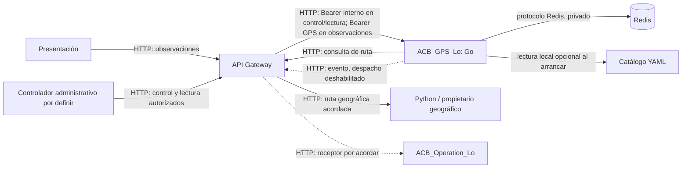

# Arquitectura, alcance y límites

**Actualización del catálogo:** Go puede cargar `GPS_POLICIES_FILE` al arrancar y registrar en Redis la huella histórica de cada política. Las instantáneas nuevas fijan referencia y valores; las anteriores conservan su hash. El catálogo sintético no habilita control ni lectura. Véase [políticas YAML](politicas-yaml.md).

**Comprobado en código:** `cmd/acb-gps` siempre registra salud y observaciones. Registra control al activar `GPS_CONTROL_API_ENABLED=true` con catálogo YAML, cliente geográfico Gateway y dos secretos válidos; registra lectura si además `GPS_READ_API_ENABLED=true`. Un verificador de credencial interna comprueba la identidad del Gateway. La autorización contextual del recorrido, lector y política se confía al Gateway como simplificación del Prototipo 2. Los valores del YAML incluido no son políticas operativas aprobadas. `GPS_OPERATIONS_DELIVERY_ENABLED=false` deja eventos en Redis y mantiene activo el trabajador de recuperación.

GPS es dueño del estado técnico, credencial de observación por sesión, posiciones temporales, instantánea geográfica inmutable, evaluaciones, transiciones y outbox. Python es dueño de rutas, LineString y puntos de encuentro. El futuro controlador administrativo debe autorizar el recorrido y entregar de forma segura la credencial al dispositivo. Operaciones procesa eventos y notificaciones; no crea ni finaliza sesiones GPS por su nombre. **Toda comunicación HTTP entre componentes pasa obligatoriamente por Gateway**; Redis y las dependencias locales de GPS son privadas. La llegada técnica no modifica reglas administrativas.

El Gateway enruta las peticiones entrantes sin modificar los contratos HTTP de GPS. La verificación Bearer de observaciones permanece en Go. Para control y lectura, GPS comprueba una credencial interna compartida; Gateway autentica y autoriza al consumidor y al recorrido antes de encaminarlos. Los handlers no se registran cuando faltan configuración o secretos. Las URLs salientes se componen con un origen del Gateway y rutas absolutas independientes, sin fallback hacia Python u Operaciones. La ruta receptora de eventos y el acuse durable todavía requieren acuerdo externo. Véase [contrato Gateway](contrato-gateway-gps.md).

**Claves Redis principales:** `gps:session:{id-codificado}`, `gps:snapshot:{id-codificado}`, `gps:position:{id-codificado}:{secuencia}`, `gps:history:{id-codificado}`, `gps:active:sessions`, `gps:control:request:{huella}`, `gps:provision:plan:{id-codificado}`, `gps:provision:pending`, `gps:finish:pending`, `gps:pending:sessions`, `gps:pending:events`, `gps:event:{event_id}`, `gps:outbox:due`, `gps:delivery:{event_id}` y `gps:outbox:blocked`. Los índices de recuperación se consultan en lotes acotados. Las reservas de control no tienen TTL hasta acordar el horizonte de reintentos.

Cada posición aceptada recibe expiración individual `max(captured_at, received_at, hora Redis) + retención + margen`; la retención mínima configurada es 24 h. Finalizar revoca la credencial y retira el índice activo, pero no borra posiciones antes del vencimiento. Los eventos pendientes no expiran por la retención GPS; después del acuse durable se aplica la retención técnica configurable. Redis standalone con AOF `appendfsync always` y `noeviction` mitiga pérdidas, pero no garantiza recuperación ante pérdida del nodo o volumen. Una falta de memoria rechaza escrituras; no se debe informar aceptación incierta como éxito.

**Bloqueos externos:** identidad y autorización entre servicios, propietario del control administrativo, políticas operativas, ampliación del contrato Python para `OperationalReady`, URL y acuse durable de Operaciones, autorización de lectores y flujo de credencial con Presentación. Véase la [matriz](matriz-habilitacion.md) para habilitar cada capacidad. La integración real no se presenta como funcional.
