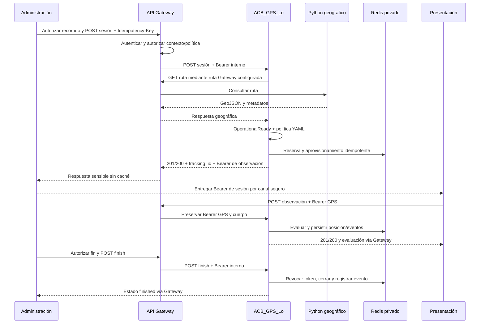

# Contrato interno Gateway ↔ GPS — Prototipo 2

**Estado:** interfaz implementada en GPS; integración con el Gateway real pendiente. Este acuerdo de Prototipo 2 sustituye la propuesta de verificador de identidad individual descrita en `propuesta-integracion-administrativa.md`, que permanece como registro histórico de la auditoría. Las rutas siguientes son **internas de GPS**. El prefijo público del Gateway y su mecanismo de identidad de usuarios los define su equipo. Todos los identificadores y datos de los ejemplos son sintéticos.

## Regla de confianza y configuración

El Gateway autentica al consumidor, comprueba su autoridad administrativa y autoriza el `trip_id`, `guide_id`, `geo_route_id`, `policy_id` y la operación solicitada. Después envía a GPS una credencial interna de servicio en `Authorization: Bearer <GPS_GATEWAY_INTERNAL_TOKEN>`. GPS compara esa credencial en tiempo constante, asigna el sujeto estable `acb-gateway` y las capacidades técnicas `tracking:create`, `tracking:finish` y `tracking:read`. El alcance contextual se delega **deliberadamente** al Gateway en el Prototipo 2. GPS no acepta cabeceras de identidad como prueba de autorización y no identifica al usuario final. La red privada debe impedir el acceso directo a GPS; el token sigue siendo obligatorio incluso dentro de esa red. Se recomienda TLS o un canal protegido entre componentes.

La credencial interna es un valor base64url sin padding de 32 a 64 bytes generados aleatoriamente, externo al repositorio. GPS valida longitud y codificación, pero no puede demostrar la entropía del origen; el equipo de despliegue debe usar un generador criptográfico. Tiene vida estática hasta que se cambie y reinicie GPS y Gateway; la ventana `NotBefore/ExpiresAt` del principal se crea para **cada verificación**, no da vencimiento al secreto compartido. Protegerlo como secreto de despliegue y rotarlo coordinadamente. El token no concede la capacidad `tracking:observe` y no sustituye al Bearer GPS de sesión. La credencial de observación se envía a GPS **sin reemplazarla** por la interna en `POST .../observations`.

`GPS_CONTROL_API_ENABLED=false` y `GPS_READ_API_ENABLED=false` por defecto. Para habilitar control se requieren `GPS_GATEWAY_BASE_URL`, `GPS_GATEWAY_ROUTES_PATH`, `GPS_POLICIES_FILE`, `GPS_GATEWAY_INTERNAL_TOKEN` y `GPS_CONTROL_CREDENTIAL_KEY`; lectura requiere además `GPS_READ_API_ENABLED=true`. El control se niega al arrancar si falta cualquiera. `GPS_CONTROL_CREDENTIAL_KEY` es una clave base64url **distinta** para derivar el Bearer GPS con HMAC-SHA256. La clave debe conservarse estable durante reintentos de creación; no está implementada la reemisión tras la ventana. La lectura sólo puede activarse junto con control en la composición actual. El YAML incluido es sintético y no aprueba recorridos reales.

GPS consulta geometría únicamente por la ruta configurada del Gateway y no sigue redirecciones. La ruta de salida requiere un `geometry_version` oficial, `association_status=verified`, extremos resueltos y PE consistentes para superar `OperationalReady`. La ausencia de esos datos devuelve 422 al crear. La entrega real de eventos a Operaciones sigue apagada.

## Operaciones internas

| Operación | Método y ruta interna | Credencial | Cabeceras adicionales | Resultado principal |
| --- | --- | --- | --- | --- |
| Crear sesión | `POST /api/v1/tracking-sessions` | Interna Gateway | `Idempotency-Key`, `Content-Type: application/json` | 201 nueva, 200 repetida |
| Consultar estado | `GET /api/v1/tracking-sessions/{tracking_id}` | Interna Gateway | Ninguna | 200 |
| Finalizar | `POST /api/v1/tracking-sessions/{tracking_id}/finish` | Interna Gateway | Cuerpo vacío | 200, incluso al repetir |
| Última posición | `GET /api/v1/tracking-sessions/{tracking_id}/latest-position` | Interna Gateway | Ninguna | 200, 204 sin posiciones, 410 expirada |
| Historial | `GET /api/v1/tracking-sessions/{tracking_id}/positions?after_sequence=N&limit=L` | Interna Gateway | Ninguna | 200 |
| Enviar GPS | `POST /api/v1/tracking-sessions/{tracking_id}/observations` | Bearer de observación exclusivo de esa sesión | `Content-Type: application/json` | 201 nueva, 200 repetida |

El Gateway debe preservar método, ruta interna, cuerpo, `Authorization`, `Idempotency-Key`, códigos, `Retry-After`, `WWW-Authenticate` y `Cache-Control: no-store`. En particular, no debe registrar la credencial devuelta en la creación ni las ubicaciones. Liveness y readiness son interfaces técnicas del despliegue y no autorizan operaciones administrativas.

### 1. Crear sesión

El controlador administrativo decide que un recorrido puede iniciar, escoge una política aprobada y conserva una clave idempotente para **esa** solicitud. El Gateway comprueba ese contexto antes de llamar a GPS. La clave identifica la solicitud junto con el sujeto estable del Gateway; dos cuerpos distintos con la misma clave reciben 409. El cuerpo máximo es 4096 bytes; se rechazan campos desconocidos.

```http
POST /api/v1/tracking-sessions HTTP/1.1
Authorization: Bearer <credencial-interna-gateway>
Idempotency-Key: start-trip-demo-1
Content-Type: application/json

{"trip_id":"trip-demo","guide_id":"guide-demo","geo_route_id":"route-demo","policy_id":"demo-school-v1"}
```

```http
HTTP/1.1 201 Created
Content-Type: application/json; charset=utf-8
Cache-Control: no-store

{"tracking_id":"tracking-demo","session":{"id":"tracking-demo","guide_id":"guide-demo","route_id":"route-demo","trip_id":"trip-demo","state":"active","started_at":"2026-11-03T12:00:00Z","last_sequence":0,"max_observation_age":900000000000,"future_skew":30000000000,"snapshot_hash":"aaaaaaaaaaaaaaaaaaaaaaaaaaaaaaaaaaaaaaaaaaaaaaaaaaaaaaaaaaaaaaaa"},"observation_credential":"<secreto-de-sesion>","credential_status":"issued"}
```

`tracking_id`, tiempos y huella los genera GPS; los valores anteriores ilustran la estructura. Repetir exactamente la solicitud devuelve **200**, la misma sesión y, durante `GPS_CONTROL_ISSUANCE_WINDOW`, la misma credencial. Al vencer esa ventana devuelve `"observation_credential":""` y `"credential_status":"reissue_required"`; al finalizar devuelve `"revoked"`. No se debe cambiar la clave tras una respuesta HTTP perdida o 503. `Idempotency-Key` y los cuatro IDs deben ser opacos, válidos y de hasta 256 bytes. **Gateway debe garantizar unicidad de la clave entre todos sus consumidores administrativos:** GPS usa un único sujeto `acb-gateway` para el espacio de reservas. Una colisión entre consumidores puede provocar 409 o devolver el resultado de una solicitud idéntica. La clave HMAC debe conservarse estable: una rotación sin protocolo puede impedir recuperar una creación reservada.

Errores: 400 `invalid_idempotency_key`, `invalid_json` o `invalid_request` (incluida política inexistente); 401 `unauthorized`; 404 `not_found` (ruta); 409 `idempotency_conflict`; 413 `request_too_large`; 415 `unsupported_media_type`; 422 `route_ineligible`; 503 `temporarily_unavailable` con `Retry-After: 1`. Un 422 geográfico del Gateway puede mapearse hoy a 503: es una inconsistencia conocida del adaptador de errores, pendiente de revisión. El Gateway debe preservar el cuerpo y el estado observados, sin traducir una incertidumbre en éxito.

### 2. Consultar estado técnico

```http
GET /api/v1/tracking-sessions/tracking-demo HTTP/1.1
Authorization: Bearer <credencial-interna-gateway>
```

```http
HTTP/1.1 200 OK
Content-Type: application/json; charset=utf-8
Cache-Control: no-store

{"session":{"id":"tracking-demo","guide_id":"guide-demo","route_id":"route-demo","trip_id":"trip-demo","state":"active","started_at":"2026-11-03T12:00:00Z","last_sequence":0,"max_observation_age":900000000000,"future_skew":30000000000,"snapshot_hash":"aaaaaaaaaaaaaaaaaaaaaaaaaaaaaaaaaaaaaaaaaaaaaaaaaaaaaaaaaaaaaaaa"}}
```

El Gateway debe autorizar quién puede consultar el estado del recorrido. GPS verifica la credencial interna; 401 significa credencial ausente/errónea, 404 sesión inexistente, 503 almacenamiento no disponible. Repetir GET es seguro; el cuerpo no contiene hash del token GPS.

### 3. Finalizar sesión técnica

El controlador administrativo autoriza el cierre. GPS revoca el Bearer GPS, conserva posiciones sujetas a retención mínima de 24 horas y registra el evento técnico de cierre en la outbox. Esto no declara por sí mismo el fin administrativo del recorrido.

```http
POST /api/v1/tracking-sessions/tracking-demo/finish HTTP/1.1
Authorization: Bearer <credencial-interna-gateway>
Content-Length: 0
```

```http
HTTP/1.1 200 OK
Content-Type: application/json; charset=utf-8
Cache-Control: no-store

{"session":{"id":"tracking-demo","guide_id":"guide-demo","route_id":"route-demo","trip_id":"trip-demo","state":"finished","started_at":"2026-11-03T12:00:00Z","finished_at":"2026-11-03T13:00:00Z","last_sequence":1,"last_captured_at":"2026-11-03T12:00:02Z","max_observation_age":900000000000,"future_skew":30000000000,"snapshot_hash":"aaaaaaaaaaaaaaaaaaaaaaaaaaaaaaaaaaaaaaaaaaaaaaaaaaaaaaaaaaaaaaaa"}}
```

Repetir el cierre devuelve 200 y no duplica el evento. 400 `unexpected_body` si se declara cuerpo; 401 credencial inválida; 404 sesión inexistente; 503 Redis o resultado incierto. Ante 503, consultar estado y reintentar el mismo cierre.

### 4. Última posición

El Gateway debe autorizar el acceso a la ubicación sensible según usuario, recorrido y rol. El Bearer GPS no puede leer.

```http
GET /api/v1/tracking-sessions/tracking-demo/latest-position HTTP/1.1
Authorization: Bearer <credencial-interna-gateway>
```

```http
HTTP/1.1 200 OK
Content-Type: application/json; charset=utf-8
Cache-Control: no-store

{"tracking_id":"tracking-demo","tracking_state":"active","position":{"sequence":1,"latitude":4.6,"longitude":-74.1,"accuracy_m":5,"captured_at":"2026-11-03T12:00:02Z","received_at":"2026-11-03T12:00:03Z","geographic_evaluation":{"snapshot_hash":"aaaaaaaaaaaaaaaaaaaaaaaaaaaaaaaaaaaaaaaaaaaaaaaaaaaaaaaaaaaaaaaa","route_status":"inside","route_reason":"uncertainty_within_radius","route_distance_meters":0,"meeting_points":[{"id":"pe-01","status":"inside","reason":"uncertainty_within_radius","distance_meters":0}]}},"age_ms":1000}
```

La evaluación puede ser un objeto geográfico estructurado. `age_ms` se calcula desde `received_at`. 204 sin cuerpo si la sesión existe pero nunca recibió posiciones; 410 `{"error":"position_expired"}` si la última posición expiró normalmente; 400 query inválida, 401 credencial inválida, 404 sesión inexistente, 503 error de almacenamiento. Consultar no renueva TTL.

### 5. Historial paginado

```http
GET /api/v1/tracking-sessions/tracking-demo/positions?after_sequence=0&limit=2 HTTP/1.1
Authorization: Bearer <credencial-interna-gateway>
```

```http
HTTP/1.1 200 OK
Content-Type: application/json; charset=utf-8
Cache-Control: no-store

{"tracking_id":"tracking-demo","tracking_state":"finished","positions":[{"sequence":1,"latitude":4.6,"longitude":-74.1,"accuracy_m":5,"captured_at":"2026-11-03T12:00:02Z","received_at":"2026-11-03T12:00:03Z","geographic_evaluation":{"snapshot_hash":"aaaaaaaaaaaaaaaaaaaaaaaaaaaaaaaaaaaaaaaaaaaaaaaaaaaaaaaaaaaaaaaa","route_status":"inside","route_reason":"uncertainty_within_radius","route_distance_meters":0,"meeting_points":[{"id":"pe-01","status":"inside","reason":"uncertainty_within_radius","distance_meters":0}]}}],"next_after_sequence":1,"has_more":false}
```

`after_sequence` es cursor exclusivo de 0 a 9007199254740991. `limit` va de 1 a `GPS_READ_MAX_PAGE_LIMIT` (máximo 100); por defecto se usa el menor entre 50 y ese límite. Los registros se ordenan por secuencia y pueden tener huecos. 400 `invalid_pagination`, 401, 404, 422 `page_too_large` o 503. En 422 reducir `limit`; en 503 repetir con el mismo cursor. El Gateway debe autorizar cada página y no almacenar respuestas en caché.

### 6. Enviar observación GPS

Presentación recibe la credencial de observación mediante un canal autorizado y la conserva sólo para esa sesión. El Gateway **preserva** ese Bearer al encaminar; no lo sustituye por el secreto interno. GPS autentica la sesión independientemente y rechaza posiciones tras el cierre.

```http
POST /api/v1/tracking-sessions/tracking-demo/observations HTTP/1.1
Authorization: Bearer <credencial-de-observacion-de-tracking-demo>
Content-Type: application/json

{"sequence":1,"latitude":4.6,"longitude":-74.1,"accuracy_m":5,"captured_at":"2026-11-03T12:00:02Z"}
```

```http
HTTP/1.1 201 Created
Content-Type: application/json; charset=utf-8
Cache-Control: no-store

{"tracking_id":"tracking-demo","sequence":1,"acceptance":"accepted","received_at":"2026-11-03T12:00:03Z","expires_at":"2026-11-04T12:05:03Z","geographic_evaluation":{"snapshot_hash":"aaaaaaaaaaaaaaaaaaaaaaaaaaaaaaaaaaaaaaaaaaaaaaaaaaaaaaaaaaaaaaaa","route_status":"inside","route_reason":"uncertainty_within_radius","route_distance_meters":0,"meeting_points":[{"id":"pe-01","status":"inside","reason":"uncertainty_within_radius","distance_meters":0}]}}
```

La evaluación ilustrada corresponde a una ruta sintética con `pe-01` en la posición indicada; la huella es de ejemplo. `not_evaluated` sólo aplica a sesiones sin instantánea evaluable. Un reintento idéntico devuelve 200 `acceptance: replayed` y el resultado original; misma secuencia con contenido distinto da 409 `sequence_conflict`; secuencia antigua da 409 `stale_observation`. 400 JSON/posición inválida, 401 token ausente/incorrecto, sesión cerrada o ajena, 413 cuerpo excesivo, 415 media type, 503 almacenamiento incierto con `Retry-After: 1`. En 503 repetir exactamente la misma observación; no avanzar secuencia sin resolver el resultado. `captured_at` requiere zona horaria y está sujeto a límites de antigüedad y desfase futuro fijados en la sesión.

## Flujo de orquestación



## Responsabilidades y acuerdos pendientes

| Equipo | Responsabilidad en este contrato | Pendiente de acuerdo real |
| --- | --- | --- |
| Administración | Decidir inicio/fin, asignación guía/recorrido/ruta, política permitida y entrega segura de token | Identidad del controlador; unicidad de sesión activa por recorrido; reemisión tardía |
| Gateway | Autenticar/autorizar consumidor y contexto, guardar secreto interno, enrutar y preservar contratos | Prefijo público, red privada/TLS, política de permisos y rotación coordinada del secreto |
| GPS | Verificar secreto interno, ejecutar seguimiento técnico, validar política/ruta, persistir y proteger ubicación | Mapear algunos errores geográficos upstream y revisar rotación HMAC |
| Python | Publicar ruta, geometría, PE y metadatos de aptitud | `geometry_version`, `association_status`, extremos y semántica de rutas que parten del colegio |
| Operaciones | Recibir y procesar acontecimientos, gestionar notificaciones | Receptor y acuse durable `gps.ack.v1`; despacho sigue apagado |
| Presentación | Enviar GPS con Bearer exclusivo de sesión; procesar respuestas y reintentos | Cadencia de envío, entrega/protección del token y comportamiento sin conectividad |

**Verificación de integración:** en un entorno aislado, configurar un Gateway simulado, Redis temporal y una ruta sintética `OperationalReady`; comprobar 401 sin credencial interna, 201/200/409 al crear, GET 200, observación 201/200 con Bearer GPS, lecturas 200 y cierre 200 con revocación. Repetir después de reiniciar Go para comprobar recuperación. Esto no sustituye pruebas con el Gateway ni con Python reales.
