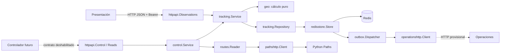
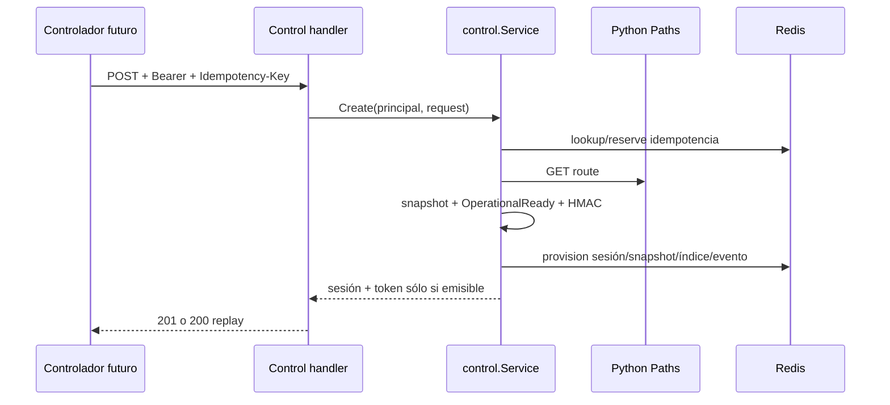
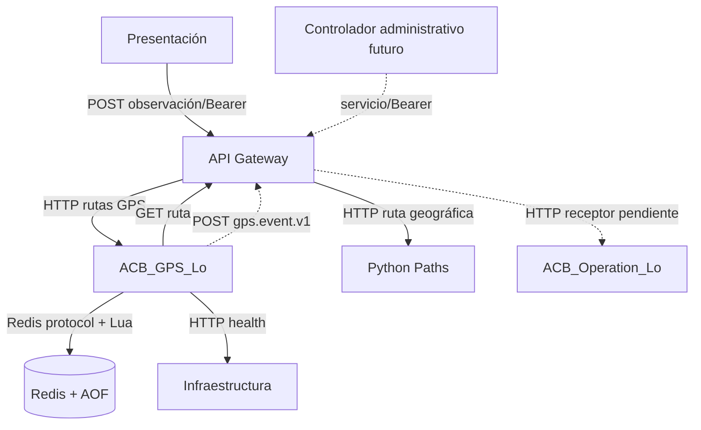
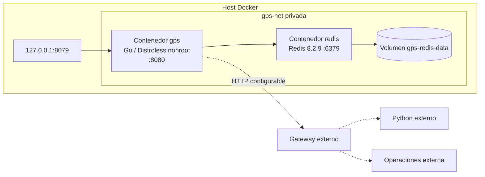
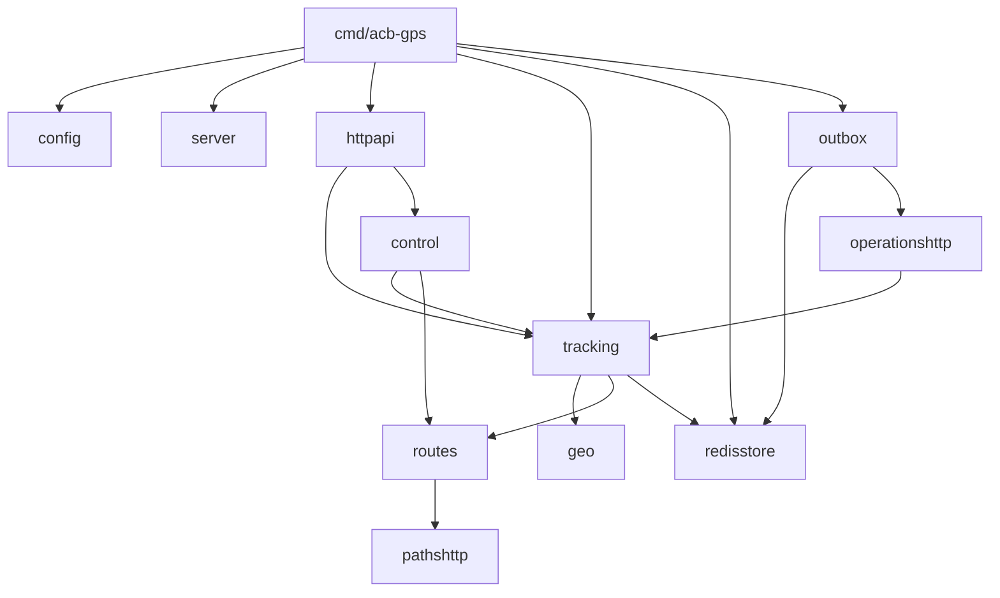

# ACB_GPS_Lo — informe técnico interno

**Fecha de inspección:** 2 de noviembre de 2026 (America/Bogota)  
**Repositorio:** `geolocaACB` · **Rama:** `feature/gpsACB` · **revisión inspeccionada:** `9adf48d`  
**Directorio:** `acb_gps_lo/`  
**Alcance:** lectura de código, configuración, Docker y documentación existente. No se iniciaron contenedores, no se ejecutaron pruebas y no se modificó código ni configuración.

## Tabla de contenidos

1. [Resumen ejecutivo](#1-resumen-ejecutivo)
2. [Arquitectura interna](#2-arquitectura-interna)
3. [Módulos y paquetes](#3-módulos-y-paquetes)
4. [Tecnologías](#4-tecnologías)
5. [Tecnologías fundamentales](#5-tecnologías-fundamentales)
6. [Patrones y mecanismos](#6-patrones-y-mecanismos)
7. [Flujos de ejecución](#7-flujos-de-ejecución)
8. [Modelo de información y Redis](#8-modelo-de-información-y-redis)
9. [Concurrencia, consistencia y recuperación](#9-concurrencia-consistencia-y-recuperación)
10. [Seguridad](#10-seguridad)
11. [Pruebas y verificación](#11-pruebas-y-verificación)
12. [Vistas arquitectónicas](#12-vistas-arquitectónicas)
13. [Decisiones arquitectónicas](#13-decisiones-arquitectónicas)
14. [Estado y limitaciones](#14-estado-y-limitaciones)
15. [Glosario y conclusiones](#15-glosario-y-conclusiones)

## 1. Resumen ejecutivo

`ACB_GPS_Lo` es el servicio técnico de seguimiento GPS en tiempo real de ACB. Recibe observaciones autenticadas de un dispositivo, conserva posiciones temporalmente en Redis, las compara con una instantánea inmutable de una ruta y sus puntos de encuentro, detecta transiciones geográficas y deja eventos listos para que Operaciones los entregue y procese. No administra rutas en MongoDB, no decide sanciones o notificaciones administrativas, ni reemplaza al componente que autorizará recorridos.

La unidad principal es una **sesión técnica**. La sesión vincula identificadores opacos de guía, recorrido y ruta, límites temporales, una credencial de observación y, si la ruta es apta, una instantánea geográfica. La posición aceptada guarda secuencia, coordenadas, precisión, tiempos, evaluación geográfica y vencimiento individual no inferior a 24 horas. Al finalizar, se revoca el token y se conserva el historial hasta que venza su TTL; los eventos pendientes sobreviven al historial.

El ejecutable operativo registra salud y recepción de observaciones. Control administrativo y lecturas están implementados y cubiertos por pruebas, pero el `main` no los conecta y `GPS_CONTROL_API_ENABLED=true` se rechaza durante el parseo de configuración. El despacho HTTP a Operaciones existe, aunque está apagado por defecto. Esta diferencia entre código implementado y superficie operativa es intencional y debe mantenerse visible durante la integración ([`cmd/acb-gps/main.go:44`](../cmd/acb-gps/main.go), [`internal/config/config.go:139`](../internal/config/config.go)).

### Responsabilidades dentro de ACB

| En GPS | Fuera de GPS |
| --- | --- |
| Estado técnico, tokens por sesión, posiciones temporales, TTL, geocercas, evaluación de ruta/PE, detección técnica de llegadas y desvíos, outbox y recuperación | Propiedad de rutas, KMZ y MongoDB (Python); autorización administrativa de inicio/cierre y proveedor de identidad (por definir); decisión/notificación administrativa (Operaciones); captura y protección de token en cliente (Presentación); enrutamiento y política perimetral (Gateway) |

## 2. Arquitectura interna

El estilo predominante es **organización modular por responsabilidades con puertos locales e infraestructura adaptadora**. Tiene rasgos de arquitectura hexagonal, pero no es una hexagonal o Clean Architecture completa: `tracking` define el contrato `Repository` y no importa Redis; `routes.Reader`, `control.Verifier` y los contratos de outbox permiten sustituir adaptadores. Sin embargo, la composición de producción crea directamente `redisstore.Store`, `tracking.Service`, el handler HTTP y los trabajadores en `main`; no hay una capa de aplicación independiente ni un contenedor DI general. Es más preciso describirlo como un núcleo de dominio/aplicación pequeño, rodeado por adaptadores explícitos.

La dirección normal de dependencias es: transporte HTTP o trabajador → casos de uso (`tracking`, `control`) → interfaces → adaptadores (`redisstore`, `pathshttp`, `operationshttp`). `geo` y `routes` son modelos/cálculo puros y no dependen de HTTP o Redis. `tracking.Service` recibe una interfaz de persistencia, calcula el resultado y delega la atomicidad al repositorio ([`internal/tracking/service.go:19`](../internal/tracking/service.go)). La excepción práctica es que `outbox` depende explícitamente del `*redisstore.Store`, porque necesita operaciones de recuperación y reclamación específicas.



**Ventajas.** Interfaces pequeñas facilitan pruebas con fakes; el cálculo geográfico se prueba sin infraestructura; HTTP no accede a Redis directamente; las dependencias externas quedan localizadas. **Compromisos.** Algunas interfaces son grandes (`tracking.Repository`), `main` conoce adaptadores concretos, y el acoplamiento de outbox a `redisstore.Store` reduce la intercambiabilidad de persistencia. La consistencia fuerte se diseña específicamente para Redis y Lua, no como abstracción portable.

## 3. Módulos y paquetes

| Paquete | Responsabilidad comprobada | Elementos relevantes y colaboradores |
| --- | --- | --- |
| `cmd/acb-gps` | Composición, señales y proceso | `run`, cliente `go-redis`, `tracking.NewService`, workers, `server.Serve`; usa configuración y adaptadores reales ([`main.go:44`](../cmd/acb-gps/main.go)) |
| `internal/config` | Leer y validar entorno | `Config`, `Load`, `Parse`; valida límites, URLs, TTL, outbox y prohíbe habilitar control sin integración ([`config.go:13`](../internal/config/config.go)) |
| `internal/server` | Mux y ciclo HTTP | `HandlerWithReads`, `Serve`, liveness/readiness, cierre por contexto ([`server.go:19`](../internal/server/server.go)) |
| `internal/httpapi` | Adaptadores HTTP entrantes | `Observations`, `Control`, `Reads`; JSON estricto, tamaño, timeouts, códigos y `Cache-Control: no-store` |
| `internal/tracking` | Dominio técnico y casos de uso | `Session`, `Position`, `Service.Receive`, instantáneas y transiciones; depende de interfaces y `geo` ([`service.go:217`](../internal/tracking/service.go)) |
| `internal/control` | Casos de uso administrativos desacoplados | `Principal`, `Verifier`, `Policies`, reservas, `Service.Create/Status/Finish`; HMAC y alcance ([`control.go:33`](../internal/control/control.go)) |
| `internal/geo` | Geometría WGS84 pura | Haversine, LineString preparada, geocercas con incertidumbre, corredor; sin Redis/HTTP ([`route.go:31`](../internal/geo/route.go)) |
| `internal/routes` | Modelo y puerto geográfico | `Route`, `MeetingPoint`, `Endpoints`, interfaz `Reader` ([`route.go:21`](../internal/routes/route.go)) |
| `internal/pathshttp` | Adaptador HTTP a Python | `Client.Get`, límites de cuerpo, decodificación de GeoJSON y errores upstream ([`client.go:65`](../internal/pathshttp/client.go)) |
| `internal/redisstore` | Repositorio Redis y scripts Lua | sesiones, posiciones, snapshots, CAS de transición, outbox, reservas, recuperación; implementación de `tracking.Repository` |
| `internal/outbox` | Workers de recuperación y entrega | `StartRecovery`, `Dispatcher`, backoff, reclamaciones y cierre controlado ([`dispatcher.go:43`](../internal/outbox/dispatcher.go)) |
| `internal/operationshttp` | Adaptador HTTP saliente | sobre `gps.event.v1`, Bearer, `Idempotency-Key`, validación estricta de `gps.ack.v1` ([`client.go:55`](../internal/operationshttp/client.go)) |
| `internal/loadtest` | Carga sintética opt-in | `TestSyntheticLoad`; no integra código de producción |

El árbol representativo es:

```text
acb_gps_lo/
├── cmd/acb-gps/main.go
├── internal/{config,server,httpapi,control,tracking,geo,routes}/
├── internal/{pathshttp,redisstore,outbox,operationshttp}/
├── internal/loadtest/
├── docs/
├── Dockerfile · compose.yaml · go.mod · go.sum
└── README.md
```

Se analizaron **13 paquetes productivos** (`main` incluido) y un paquete de carga. Los paquetes `internal` no son importables desde fuera del módulo: Go aplica esa restricción en compilación.

## 4. Tecnologías

| Tecnología | Versión utilizada | Categoría | Uso y ubicación | Justificación comprobable |
| --- | --- | --- | --- | --- |
| Go | módulo declara 1.27.0; imagen 1.27.3 | Lenguaje/runtime | todo el servicio; `go.mod`, Dockerfile | binario estático, goroutines, interfaces y biblioteca estándar |
| `net/http`, `context`, `encoding/json`, `log/slog` | estándar Go | transporte/observabilidad | servidor, clientes, JSON, cancelación, logs | evita framework HTTP adicional |
| `github.com/redis/go-redis/v9` | 9.17.3 | dependencia directa | `main`, `redisstore`, pruebas | cliente Redis con contextos y scripting |
| `xxhash/v2`, `go-rendezvous` | 2.3.0; pseudo-versión indicada | transitivas | `go.sum` vía go-redis | no se importan directamente por la aplicación |
| Redis | imagen 8.2.9-bookworm fijada por digest | almacenamiento temporal | Compose, `redisstore` | claves, hashes/strings, sorted sets, TTL, Lua, AOF |
| Lua Redis | versión no declarada por proyecto | scripting embebido | `redisstore/scripts.go`, `delivery_scripts.go` | operaciones de varias claves atómicas |
| HTTP/1.x REST + JSON | estándar/protocolo | integración | entrada GPS, Paths, Operaciones | interoperabilidad entre componentes |
| Bearer, HMAC-SHA256, SHA-256 | estándar Go | seguridad | `tracking`, `control`, adaptadores HTTP | credencial por sesión, hash y firmas derivadas |
| Docker | versión de host no fijada | despliegue | Dockerfile multi-etapa | aislamiento y reproducibilidad |
| Compose | especificación sin versión explícita | orquestación local | `compose.yaml` | red/volumen/healthchecks independientes |
| Distroless Debian 13 nonroot | digest fijado | imagen runtime | Dockerfile | imagen mínima, sin shell y usuario no privilegiado |
| `testing`, `httptest`, `go vet`, `-race` | estándar Go | prueba/análisis | archivos `*_test.go` | pruebas unitarias, HTTP, concurrencia y carreras |
| OpenAPI 3.1 / Markdown / Mermaid | versión OpenAPI 3.1.0 | documentación | `docs/openapi.yaml`, documentos | contratos y transferencia de conocimiento |

## 5. Tecnologías fundamentales

### Go

Go aporta ejecución concurrente con goroutines y canales: el servidor inicia su goroutine interna en `server.Serve`, y `outbox.Dispatcher` lanza un monitor y trabajadores. `context.Context` transporta cancelación desde HTTP, Redis y clientes salientes; durante SIGTERM, `signal.NotifyContext` inicia el cierre ordenado ([`main.go:79`](../cmd/acb-gps/main.go)). Interfaces son contratos explícitos, por ejemplo `tracking.Repository` y `control.Verifier`, lo que permite fakes en pruebas. Los errores son valores y se clasifican con `errors.Is/As`; no hay excepciones.

Frente a Python/FastAPI, el servicio no depende de un framework web ni de un ORM. Go se eligió coherentemente para una ruta frecuente de I/O y concurrencia, aunque el repositorio no demuestra por sí mismo un rendimiento superior: sólo ofrece mecanismos y pruebas de carga sintéticas.

### Redis y Lua

Redis es un almacén en memoria con persistencia opcional. Aquí retiene datos de seguimiento, no la fuente maestra de rutas. AOF está habilitado con `appendfsync always`; `noeviction` evita expulsar silenciosamente datos bajo presión, a cambio de rechazar escrituras cuando no hay memoria ([`compose.yaml:52`](../compose.yaml)). Eso reduce pérdida por caída de proceso, pero no protege contra pérdida de nodo o volumen.

Lua se ejecuta dentro de Redis y serializa un script frente a otros comandos: permite comprobar sesión/secuencia, escribir posición, actualizar historial/estado y registrar eventos como unidad lógica. No ofrece rollback automático ante un error de script ya escrito; por eso el código valida argumentos antes y conserva planes pendientes para recuperación. Una respuesta de red perdida deja resultado incierto: el servicio lee/reconcilia en vez de confirmar a ciegas.

### HTTP y REST

`net/http` usa un `ServeMux` con patrones de método. `httpapi.Observations` valida método, path, Authorization, media type, tamaño y JSON antes de llamar a `tracking.Service`. Las respuestas son JSON, códigos explícitos y no almacenables. Clientes a Python y Operaciones usan `http.Client`, límites de cuerpo, timeout, contexto y sin seguir redirecciones. Bearer para GPS está limitado a una sesión; Bearer administrativo es una abstracción aún no conectada a identidad real.

### Docker y Compose

El Dockerfile compila en `golang:1.27.3-bookworm` con `CGO_ENABLED=0`, `-trimpath`, `-buildvcs=false` y binario reducido; la etapa final es Distroless nonroot. Compose crea los contenedores `acb_gps_lo` y `acb_gps_redis`, red privada `gps-net` y volumen `gps-redis-data`. Go publica sólo `127.0.0.1:8079` hacia el host; Redis no publica puerto. Un healthcheck propio consulta readiness y el de Redis ejecuta `redis-cli ping`. Python/MongoDB no comparten imagen, red ni volumen por defecto.

## 6. Patrones y mecanismos

| Patrón | Implementación y ejemplo | Beneficio / límite |
| --- | --- | --- |
| Repository / puerto | `tracking.Repository` en [`service.go:19`](../internal/tracking/service.go); `redisstore.Store` | dominio testeable; interfaz extensa y diseñada para Redis |
| Inyección manual | constructores `NewService`, `httpapi.NewObservations`, `control.New`; `main.run` compone | explícito y simple; composición central aún concreta |
| Snapshot inmutable | `BuildSnapshotWithTransitions`; hash de geometría/política | evita reinterpretar GPS después de editar Python; consume espacio y requiere ruta apta |
| Idempotencia | huella de entrada de posición y reserva `Idempotency-Key` para creación | reintentos seguros; reservas de control no tienen TTL acordado |
| CAS optimista | `GeographicState.LastSequence`/`ExpectedSequence`, `ErrStateChanged` y hasta 8 reintentos | evita mezclar transiciones concurrentes; puede terminar en `ErrPending` |
| Transactional outbox interno | evento + transición + posición en scripts; `gps:outbox:due` | no depende de historial para entregar; no hay exactly-once externo |
| Lease / consumer reclamable | `ClaimEvent` entrega token y vence lease; `SettleEvent` exige token | recupera trabajador caído; puede reenviar, por diseño |
| Retry con backoff y jitter | `Dispatcher.backoff` duplica espera y añade variación | reduce tormentas; requiere dimensionar cola |
| Recovery worker | `StartRecovery` procesa índices acotados y planes pendientes | recupera sin nuevo GPS; planes irrecuperables requieren intervención |
| CQRS parcial | recepción/modificación en `tracking`; consultas `Latest/History` separadas | separa intención, pero no hay buses ni modelos de lectura distintos |

## 7. Flujos de ejecución

### A. Creación de sesión (implementada, no conectada al mux operativo)

1. `httpapi.Control` autentica un `control.Principal`, exige capacidad y `Idempotency-Key`.
2. `control.Service.Create` calcula huella de solicitud e inspecciona/reserva `gps:control:request:*`.
3. Consulta `routes.Reader`; el adaptador `pathshttp` llama `GET /api/v1/routes/{id}`.
4. Resuelve política, construye snapshot, exige `OperationalReady`, deriva HMAC de credencial y llama `ProvisionPrepared`.
5. `redisstore` aprovisiona sesión, hash de token, snapshot e índice activo de forma coordinada; la activación queda como evento interno.
6. La respuesta entrega secreto sólo en ventana de emisión. Ante duda de escritura, se relee/reintenta con mismo ID y material.

Fallas: identidad/alcance (401/403), clave con otro cuerpo (409), ruta no apta (422), Python/Redis inciertos (503). El flujo no autoriza reglas de negocio administrativas.



### B. Recepción GPS y C. evaluación geográfica

`POST /api/v1/tracking-sessions/{id}/observations` es la superficie registrada. El handler restringe el cuerpo, exige `application/json`, decodifica sin campos extras y crea un contexto con timeout. `tracking.Service.Receive` verifica token contra SHA-256 usando comparación constante, valida secuencia/coordenadas/precisión/tiempo y busca un replay antes de considerar antigüedad.

Si existe snapshot, se carga una vez y se conserva en `sync.Map` como ruta preparada. El motor calcula distancia mínima a segmentos de LineString, no sólo a vértices; usa arco corto/vector unitario para segmentos dentro de sus límites (5 km por segmento, 100 km total, ±70°, sin antimeridiano ambiguo). `EvaluateCircle` y `EvaluateCorridor` usan distancia ± precisión: `inside` sólo cuando el intervalo completo cabe, `outside` cuando queda fuera, e `indeterminate` si la incertidumbre cruza el borde. `not_evaluated` significa que nunca se aplicó el motor, no incertidumbre.

### D. Acontecimientos

`tracking.Advance` es puro: toma snapshot, estado previo y posición evaluada, y produce un `TransitionPlan`. Exige evidencia consecutiva, dwell, cantidades y máximo hueco de muestra fijados por sesión. Una llegada se confirma con PE `inside` inequívoco; un desvío necesita varias muestras `outside`, y la resolución varias `inside`. El plan puede crear primera llegada, llegada posterior o inicio/resolución de desvío. Una sola posición fuera no genera evento administrativo. `AcceptTransition` aplica CAS sobre la secuencia/estado y persiste posición, nuevo estado y eventos; si otro escritor avanzó, `Receive` recalcula.

### E. Outbox y despacho

Los eventos autocontenidos se guardan como `gps:event:{event_id}` y se programan en `gps:outbox:due`. `Dispatcher` reclama con lease/token, llama `operationshttp.Client.Deliver` y sólo marca entregado ante HTTP 200/201 más ack JSON exacto. Timeouts, 429 y 5xx vuelven a `pending` con backoff; contrato/ack inválido se vuelve `blocked`; respuesta perdida puede causar reentrega. Operaciones debe deduplicar durablemente por `event_id`: la garantía es **al menos una vez**, no exactly-once.

### F. Lecturas y G. cierre

`control.Service.Latest/History` comprueba primero alcance sobre la sesión persistida. `Reads` pagina por `after_sequence` exclusivo y `limit`, omite claves expiradas y no amplía TTL. Última inexistente es 204, vencida 410, problema inesperado 503. `Finish` cambia estado a `finished`, revoca token, retira el índice activo, genera evento técnico y conserva datos sujetos a TTL. Un cierre repetido no recrea efectos. Los handlers no están registrados aún.

## 8. Modelo de información y Redis

| Entidad Go | Contenido esencial | Persistencia / vida |
| --- | --- | --- |
| `tracking.Session` | IDs, estado, inicio/fin, última secuencia, límites, hash de snapshot | `gps:session:{id codificado}`; permanece para estado e historial |
| `tracking.Position` | secuencia, coordenadas, precisión, captura/recepción, evaluación, primera llegada | `gps:position:{id}:{seq}`; TTL individual ≥24 h + margen |
| `GeographicSnapshot` | `Route`, política, política transicional, límites, huellas | `gps:snapshot:{id}`; no debe vencer antes de necesidad de sesión/historial |
| `GeographicState` | progreso de PE, candidatos, desvío, última secuencia | dentro de sesión/estado de transición; CAS |
| `tracking.Event` | ID determinista, tipo, IDs, evidencia geográfica | `gps:event:{event_id}`; pendiente sin TTL prematuro |
| Historial | índice secuencia → posición | `gps:history:{id}` sorted set; referencias expiradas se omiten/limpian acotadamente |
| Activas | sesiones activas | `gps:active:sessions` sorted set |
| Idempotencia | propietario, clave, huella, sesión/snapshot | `gps:control:request:{hash}`; sin TTL actual |
| Recuperación/outbox | planes, pendientes, due, delivery y bloqueados | `gps:provision:pending`, `gps:pending:sessions`, `gps:pending:events`, `gps:outbox:due`, `gps:delivery:*`, `gps:outbox:blocked` |

La expiración de una posición usa el máximo entre `captured_at`, `received_at` y hora Redis, más retención y margen. Un reintento devuelve el vencimiento original: nunca lo renueva. Eventos entregados conservan evidencia por `GPS_OUTBOX_DELIVERED_RETENTION`; pendientes no se borran para resolver indisponibilidad.

## 9. Concurrencia, consistencia y recuperación

**Dos GPS con la misma secuencia.** El primer script acepta y persiste. Si el segundo tiene huella igual, se recupera la aceptación original; si difiere, `ErrConflict`. Si el segundo es una secuencia antigua, se rechaza. La atomicidad está en Redis, no en el mutex local.

**Dos evaluaciones distintas de una sesión.** Ambas pueden calcular desde el mismo estado, pero `AcceptTransition` compara la secuencia esperada. Una gana; la otra recibe `ErrStateChanged`, recarga estado y recalcula hasta ocho veces. Sesiones distintas usan claves distintas y no mezclan sus estados.

**Redis respondió tarde o se perdió la red.** Go no confirma éxito. `ProvisionPrepared` y `replay` vuelven a consultar con el mismo ID/digest/huella; los planes pendientes permiten reparar una secuencia parcialmente persistida. Redis atomicidad no equivale a durabilidad absoluta: AOF y volumen pueden perderse en fallo de infraestructura.

**Operaciones recibió evento y se perdió el ack.** GPS no marca entrega y, al vencer lease/reintento, reenvía el mismo `event_id`. Operaciones debe guardar deduplicación y efecto en una misma transacción local. Esta es la razón técnica de entrega al menos una vez.

**Redis reinicia.** AOF/volumen pueden restaurar claves, snapshots y outbox; `StartRecovery` revisa índices en lotes y reclamaciones vencidas. Una caída con pérdida de volumen queda fuera de la garantía. `noeviction` convierte memoria insuficiente en error visible, protegiendo la semántica de no confirmar una observación no verificable.

## 10. Seguridad

**Implementado:** observación Bearer por sesión; token aleatorio de 32 bytes o HMAC derivado en flujo de control; Redis conserva SHA-256, y `subtle.ConstantTimeCompare` compara digest ([`service.go:195`](../internal/tracking/service.go)). Se validan tamaños/JSON/tiempos, no se exponen tokens, hay `Cache-Control: no-store`, Redis no se publica al host y la imagen corre sin privilegios. Eventos salientes llevan Bearer configurable y clientes limitan cuerpos.

**Pendiente de integración:** proveedor real de identidad, TLS/certificados, fuente de políticas autorizadas, entrega/rotación segura de token, registro de endpoints control/lectura, autorización de lectores y receptor real de Operaciones. `Idempotency-Key` evita duplicación técnica; no es autenticación. No debe habilitarse control con verificadores de pruebas ni basarse en cabeceras de identidad del cliente.

## 11. Pruebas y verificación

Hay pruebas unitarias para modelos, validadores, geodesia y handlers; `httptest` para HTTP y receptores simulados; Redis temporal para repositorio, TTL, scripts, carrera, outbox y reinicios; `go test -race -p 1 ./...` para carreras; y carga opt-in en `internal/loadtest`. Las pruebas relevantes incluyen `TestIsolatedContractFlow`, `TestSyntheticLoad`, suites `redisstore`, `outbox`, `operationshttp`, `pathshttp` y `tracking`.

Comandos documentados: `go test ./...`, `go vet ./...`, `go mod verify`, `go test -race -p 1 ./...`; integración sólo con `GPS_TEST_REDIS_ADDR` y `GPS_TEST_REDIS_ISOLATED=1` contra Redis temporal. Algunos tests realizan `FLUSHDB` en bases de prueba: nunca apuntar al Redis permanente. En esta inspección no ejecuté ninguno, por lo que las mediciones históricas de carga en `docs/pruebas-integracion.md` son evidencia documental, no resultados de esta ejecución.

## 12. Vistas arquitectónicas

### C&C



### Despliegue



### Módulos



## 13. Decisiones arquitectónicas

| Decisión | Problema / alternativa | Beneficio y trade-off |
| --- | --- | --- |
| Redis temporal con AOF + `noeviction` | posiciones frecuentes; alternativa MongoDB/BD relacional/eviction | latencia y scripts atómicos; memoria finita, pérdida de nodo no cubierta |
| TTL individual ≥24 h | retención mínima sin borrar al cerrar; alternativa TTL por sesión | cumple retención por captura; deja índices que requieren limpieza acotada |
| Snapshot por sesión | Python puede editar ruta; alternativa consultar por posición | consistencia histórica y menos HTTP; snapshot consume espacio y exige contrato rico |
| Lua/CAS | varias claves y concurrencia; alternativa transacciones cliente/locks distribuidos | atomicidad breve y control por secuencia; lógica Redis específica y recuperación compleja |
| Outbox at-least-once | fallo entre evento/HTTP; alternativa envío síncrono | no bloquea GPS por Operaciones; receptor debe deduplicar |
| API administrativa deshabilitada | identidad no acordada; alternativa token temporal permisivo | evita bypass inseguro; bloquea integración real hasta composición nueva |
| `net/http` estándar | API pequeña; alternativa framework | pocas dependencias y control explícito; más código de validación manual |

Estas son interpretaciones técnicas respaldadas por el código, no necesariamente la motivación histórica declarada por sus autores.

## 14. Estado y limitaciones

**Implementado y conectado:** proceso Docker independiente, salud, Redis, observaciones Bearer, persistencia/TTL/idempotencia, snapshots sintéticos, motor geo, transiciones, outbox, recuperación y despacho opcional. **Implementado pero deshabilitado:** control, lectura, proveedor de identidad simulado de pruebas y contratos administrativos. **Dependencias externas:** propietario del control administrativo, identidad, políticas operativas, expansión del contrato Python, receptor/ack de Operaciones, Gateway/Presentación y TLS.

Riesgos abiertos: Redis standalone no garantiza recuperación ante pérdida de volumen; reservas de idempotencia no tienen política de limpieza final; rutas reales actuales no cumplen `OperationalReady` por faltar versión/estado de asociaciones; Go no verifica confianza global de asociaciones; la semántica de extremos externos es ambigua. En especial, RF-09 describe rutas 542 con inicio en colegio y `OperationalReady` exige que `start_meeting_point_id` sea el primer PE: puede necesitar cambio de contrato y código, no una relajación silenciosa. El historial GPS conserva mínimo 24 h, pero la retención administrativa definitiva y la recuperación ante desastre deben acordarse.

Para una prueba extremo a extremo se necesitan: ruta Python con versión/estado/extremos aptos, política aprobada, proveedor de identidad y secreto, composición que registre control/lectura, canal seguro de token, receptor de Operaciones durable y entorno Docker/red/TLS acordado.

## 15. Glosario y conclusiones

| Término | Significado en ACB_GPS_Lo |
| --- | --- |
| TTL | vencimiento por clave Redis; no se renueva por reintento/lectura |
| Snapshot | copia congelada de ruta, PE y políticas enlazada por hash a la sesión |
| CAS | comparar estado/secuencia esperada antes de aplicar una transición |
| Idempotencia | repetir una solicitud idéntica sin duplicar efecto |
| Outbox | almacenamiento durable local de evento antes de entrega HTTP |
| Lease | reclamación temporal que permite recuperar trabajo de worker caído |
| At least once | puede haber repetición; receptor deduplica por ID |
| `OperationalReady` | validación estricta adicional a ruta consultable/evaluable |

La implementación está diseñada para que la ruta crítica de GPS sea verificable, recuperable y desacoplada de decisiones administrativas. Su punto fuerte es combinar secuencia, hashes, scripts Redis y outbox para no confundir una respuesta incierta con éxito. Su límite principal no es geográfico sino de integración: la seguridad de control, autoridad administrativa y contrato geográfico oficial aún deben concretarse. Hasta entonces, el estado seguro del binario es recibir sólo sesiones internas/sintéticas y mantener deshabilitadas las rutas administrativas y de lectura.

### Referencias de código principales

- [`cmd/acb-gps/main.go`](../cmd/acb-gps/main.go): composición, señales, workers y servidor.
- [`internal/tracking/service.go`](../internal/tracking/service.go): autenticación, recepción, replay y CAS.
- [`internal/tracking/snapshot.go`](../internal/tracking/snapshot.go) y [`transitions.go`](../internal/tracking/transitions.go): aptitud, snapshot, eventos y transiciones.
- [`internal/redisstore/store.go`](../internal/redisstore/store.go), [`scripts.go`](../internal/redisstore/scripts.go), [`events.go`](../internal/redisstore/events.go): claves, TTL y atomicidad.
- [`internal/geo/route.go`](../internal/geo/route.go) y [`geofence.go`](../internal/geo/geofence.go): geometría y precisión.
- [`internal/outbox/dispatcher.go`](../internal/outbox/dispatcher.go): recuperación, lease y reintentos.
- [`internal/httpapi/`](../internal/httpapi): contratos HTTP entrantes; [`internal/pathshttp/client.go`](../internal/pathshttp/client.go) y [`internal/operationshttp/client.go`](../internal/operationshttp/client.go): adaptadores salientes.
