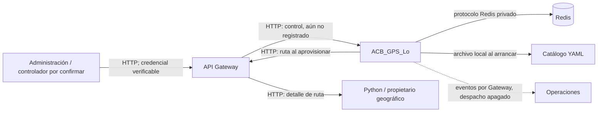

# Propuesta de integración administrativa de ACB_GPS_Lo mediante API Gateway

**Fecha:** 2026-11-03 · **Repositorio:** `geolocaACB` · **Rama:** `feature/gpsACB` · **Revisión inspeccionada:** `744799e`  
**Alcance:** análisis de solo lectura del código de `acb_gps_lo`. Este documento **no habilita** los endpoints ni fija un contrato de identidad con otros equipos. Las referencias `internal/...` se cuentan desde la raíz del componente.

## 1. Resultado ejecutivo y evidencia

**Hecho comprobado.** El proceso operativo registra salud y `POST /api/v1/tracking-sessions/{tracking_id}/observations`. Los tres handlers administrativos existen y se prueban aisladamente, pero `main.go` llama a `server.HandlerWithTracking`, que pasa `nil` para control y lectura (`cmd/acb-gps/main.go:77-117`; `internal/server/server.go:22-47`). Además, `config.Parse` rechaza expresamente `GPS_CONTROL_API_ENABLED=true` (`internal/config/config.go:168-178`). En el binario actual las rutas administrativas reciben el 404 genérico de `net/http`; no hay una respuesta JSON del handler ni autorización administrativa operativa.

**Conclusión.** No basta cambiar una variable ni encaminar tráfico desde Gateway. Faltan un verificador de identidad aprobado, autorización de elección de política, composición de dependencias y rutas geográficas aptas. `ACB_Operation_Lo` sigue siendo receptor de acontecimientos, no autoridad de creación o cierre. El consumidor controlador administrativo debe confirmarse con el equipo correspondiente.

No se encontró en este repositorio una implementación del Gateway ni del controlador administrativo que permita verificar sus endpoints, credenciales o reglas. Sus obligaciones descritas aquí son **requisitos propuestos de integración**, no capacidades externas comprobadas.

## 2. Inventario de endpoints y composición actual

| Método y ruta | Código existente | Estado operativo y dependencia |
| --- | --- | --- |
| `POST /api/v1/tracking-sessions` | `httpapi.Control.create` → `control.Service.Create` | Implementado; **no registrado**. Requiere identidad, permiso, política, ruta apta y Redis. |
| `GET /api/v1/tracking-sessions/{tracking_id}` | `httpapi.Control.status` → `control.Service.Status` | Implementado; **no registrado**. Requiere `tracking:read` y alcance de sesión o recorrido. |
| `POST /api/v1/tracking-sessions/{tracking_id}/finish` | `httpapi.Control.finish` → `control.Service.Finish` | Implementado; **no registrado**. Requiere `tracking:finish` y alcance. |
| `POST /api/v1/tracking-sessions/{tracking_id}/observations` | `httpapi.Observations` | Registrado para sesiones previamente aprovisionadas; Bearer GPS exclusivo de la sesión. |
| `GET .../latest-position`, `GET .../positions` | `httpapi.Reads` | Implementados, **no registrados**; su habilitación se tratará por separado. |

`httpapi.NewControl` exige `Controller`, `control.Verifier` y timeout válido. El handler impone `Cache-Control: no-store`, Bearer, límite de 4096 bytes y JSON sin campos desconocidos en creación (`internal/httpapi/control.go:20-117`). `server.HandlerWithControl` ya conoce las tres rutas y sólo las añade si recibe un handler no nulo (`internal/server/server.go:22-47`). Las pruebas usan `mockVerifier` y `flowVerifier`, definidos únicamente en archivos `_test.go`; no son proveedores de identidad (`internal/httpapi/control_test.go:19-25`; `internal/control/integration_flow_test.go:40-46`).

El proceso ya construye un cliente Redis, `redisstore.Store` y `tracking.Service`. Si `GPS_POLICIES_FILE` está definido, carga el catálogo y registra sus huellas históricas en Redis, pero **no inyecta** el catálogo en `control.Service` (`cmd/acb-gps/main.go:44-83`). Tampoco construye `pathshttp.Client`, `control.Service` ni `httpapi.Control` (`cmd/acb-gps/main.go:77-117`). La interfaz `routes.Reader` se satisface con `pathshttp.Client`; este cliente ya exige origen Gateway y plantilla de ruta, utiliza contexto, timeout, tamaño máximo y evita redirecciones (`internal/routes/route.go:20-23`; `internal/pathshttp/client.go:18-40,72-123`).

## 3. Modelo de seguridad actual y brechas para producción

`control.Verifier.Verify(ctx, token)` devuelve `Principal{Subject, Audience, NotBefore, ExpiresAt, Capabilities, TripIDs, TrackingIDs}`. `authenticateControl` exige una sola cabecera `Authorization: Bearer ...`, limita su longitud y valida sujeto, audiencia `acb-gps-control` y vigencia; **la verificación criptográfica del token queda a cargo del implementador de `Verifier`** (`internal/control/control.go:22-58`; `internal/httpapi/control.go:64-76`). `Principal.Allows` comprueba capacidad y alcance: creación necesita `tracking:create` y `trip_id`; consulta necesita `tracking:read` y `tracking_id` o `trip_id`; cierre necesita `tracking:finish` y el mismo alcance. Una sesión ajena devuelve 404 después de leer su `trip_id`, para reducir la revelación de existencia (`internal/control/control.go:133-142,226-241,278-297`).

**Brecha comprobada: selección de política.** `Create` llama a `Policies.Resolve(policy_id)` y verifica que la referencia coincide, pero `Principal` no expresa políticas permitidas y `Allows` no comprueba `policy_id` (`internal/control/control.go:37-58,151-167`). El catálogo YAML valida definiciones; **no autoriza** a un consumidor a seleccionarlas (`internal/policies/catalog.go:45-160`). Antes de habilitar control se necesita una decisión verificable, por ejemplo políticas permitidas por identidad y recorrido o una autorización consultable del controlador. La ausencia de permiso debe fallar cerrada antes de aprovisionar. No usar la mera presencia del ID en YAML como autorización.

**Identidad vía Gateway: propuesta.** Acordar uno de estos mecanismos antes de implementarlo: (a) Gateway reenvía un token de servicio emitido por una autoridad confiable y Go valida firma, emisor, audiencia, vigencia, sujeto y alcances; o (b) Gateway entrega una aserción de servicio firmada, de vida corta, cuyo emisor y firma Go puede verificar. Un servicio de introspección puede ser alternativa si sus disponibilidad y latencia son aceptables. En todos los casos la credencial debe estar ligada al consumidor real y Go debe validar permisos; no confiar en `X-User`, `X-Role`, `X-Trip-ID` u otras cabeceras que el cliente pueda enviar. Gateway debe eliminar cabeceras de identidad del cliente que no respalde y proteger el canal hacia GPS. El formato del token, claves/JWKS, rotación, revocación, TLS, reloj tolerado y propagación de errores requieren acuerdo con Gateway y el proveedor de identidad. No hay un verificador de este tipo en el código actual.

El Bearer de observación pertenece a una sola sesión: `tracking.Service.Authenticate` decodifica 32 bytes, compara SHA-256 en tiempo constante con el hash de Redis y exige sesión activa; no concede control ni lectura (`internal/tracking/service.go:189-217`; `internal/redisstore/store.go:206-259`). El futuro verificador administrativo debe rechazarlo por emisor/audiencia/capacidad aunque llegue desde Gateway. `GPS_GATEWAY_ROUTES_TOKEN` sirve únicamente para la **salida** GPS → Gateway hacia geografía; no verifica solicitudes administrativas entrantes (`internal/config/config.go:92-122`; `internal/pathshttp/client.go:72-89`). Tampoco debe reutilizarse `GPS_OPERATIONS_TOKEN`.

## 4. Contratos HTTP implementados, actualmente inactivos

Las siguientes respuestas describen el **handler aislado**, no el binario actual. Gateway debe preservar método, ruta, `Authorization`, `Idempotency-Key`, cuerpo, códigos y `Cache-Control: no-store` sin cambiar el contrato. La ruta pública externa que Gateway decida publicar no está acordada.

### Creación

`POST /api/v1/tracking-sessions` con `Authorization: Bearer <credencial-servicio>`, un `Idempotency-Key` opaco válido, `Content-Type: application/json` y cuerpo JSON con exactamente `trip_id`, `guide_id`, `geo_route_id`, `policy_id`. Todos son identificadores opacos no vacíos, sin espacios externos ni caracteres de control y de máximo 256 bytes (`internal/control/control.go:60-72`; `internal/tracking/model.go:117-129`). El catálogo exige que el ID de política existente termine en `-vN` y coincida con su revisión (`internal/policies/catalog.go:45-93`).

Una creación confirmada devuelve **201** con `tracking_id`, `session`, `observation_credential` y `credential_status:"issued"`; un reintento con la misma identidad, clave y cuerpo devuelve **200** y la misma sesión. La respuesta siempre incluye `observation_credential`, incluso si está vacío. Dentro de la ventana de emisión configurada, el mismo material se deriva con HMAC-SHA256 del ID de sesión y una clave externa de al menos 32 bytes; Redis guarda sólo su hash. Tras la ventana, el reintento devuelve `credential_status:"reissue_required"` y credencial vacía; si ya finalizó, `"revoked"`. No existe todavía un endpoint de rotación/reemisión tardía. La ventana permitida por `control.New` es mayor que cero y como máximo una hora (`internal/control/control.go:116-124,130-224`; `internal/tracking/service.go:123-158`).

La clave de idempotencia se vincula al sujeto y audiencia del principal y a la huella del JSON solicitado. La reserva incluye sesión e instantánea antes del aprovisionamiento, no tiene TTL y se recupera con la misma clave tras una respuesta incierta. Dos solicitudes concurrentes con la misma identidad/clave no deben crear sesiones distintas; una clave repetida con otro cuerpo da **409**. El `Subject` del token de servicio debe permanecer estable entre reintentos; cambiarlo cambia el espacio de idempotencia. Esto no impone todavía unicidad administrativa de sesión activa por `trip_id` (`internal/control/control.go:133-211`; `internal/redisstore/control.go:16-80`).

### Consulta y finalización

**Clave HMAC y reintentos:** la clave de derivación debe sobrevivir reinicios y conservarse mientras existan reservas reintentables. Si cambia, el token ya entregado puede seguir autenticando observaciones porque Redis conserva su hash, pero `Create` deriva otro material al repetir la solicitud y `ProvisionPrepared` puede detectar un digest incompatible en la sesión activa. No existe un protocolo de rotación compatible con reservas anteriores; hay que diseñarlo y probarlo antes de operar con claves rotables. Nunca registrar ni persistir el token en claro (`internal/control/control.go:192-224`; `internal/tracking/service.go:139-157`; `internal/redisstore/store.go:90-155`).

`GET /api/v1/tracking-sessions/{tracking_id}` devuelve **200** `{"session":{...}}` para quien tenga `tracking:read` y alcance de seguimiento/recorrido. La sesión JSON contiene ID, IDs de guía/ruta/recorrido, estado técnico, tiempos y metadatos de observación; no expone el hash de credencial ni `LastPositionExpiresAt` (`internal/control/control.go:226-241`; `internal/tracking/model.go:37-54`).

`POST /api/v1/tracking-sessions/{tracking_id}/finish` no requiere cuerpo y devuelve **200** `{"session":{...}}`. Exige `tracking:finish`, consulta el `trip_id` persistido antes de autorizar y llama al cierre técnico. Repetir el cierre devuelve estado finalizado sin duplicar su evento; Redis revoca `credential_hash`, retira el índice activo y conserva posiciones sujetas a retención. El evento técnico de finalización permanece en outbox aunque el despacho a Operaciones esté apagado (`internal/control/control.go:278-297`; `internal/redisstore/store.go:525-592`; `internal/redisstore/scripts.go:181-220`). La autorización para **decidir** el fin administrativo corresponde al controlador, no a Go.

### Errores observados en el handler

| HTTP | Código JSON / caso | Reintento recomendado |
| --- | --- | --- |
| 400 | `invalid_idempotency_key`, `invalid_json`, `invalid_request`, `unexpected_body`; una política inexistente llega hoy como `invalid_request` | Corregir solicitud o ID; no cambiar la clave de una solicitud que ya pudo reservarse. |
| 401 | `unauthorized`, Bearer ausente/inválido o principal no verificable | Renovar credencial administrativa; no probar con Bearer GPS. |
| 403 | `forbidden`, falta capacidad o alcance del `trip_id` al crear; capacidad ausente al consultar/cerrar | Obtener autorización del controlador; no reintentar ciegamente. |
| 404 | `not_found`, ruta inexistente o sesión inexistente/ajena | Comprobar IDs y autorización. **En el binario actual**, el 404 de control es el 404 genérico del mux. |
| 409 | `idempotency_conflict`, misma clave con contenido distinto o conflicto de aprovisionamiento | Investigar conflicto; no crear otra sesión con una clave improvisada. |
| 413 / 415 | `request_too_large` / `unsupported_media_type` al crear | Corregir tamaño o media type. |
| 422 | `route_ineligible`, `OperationalReady` o geometría rechazada | Corregir contrato/datos geográficos; no relajar el guard. |
| 503 | `temporarily_unavailable`, otros errores de Redis, resultado incierto, Gateway/Python no disponible o respuesta no clasificada; `Retry-After: 1` | Repetir la **misma** solicitud y clave con espera; comprobar estado antes de cambiar de clave. |

Mapeo comprobado en `internal/httpapi/control.go:143-165` y `internal/httpapi/observations.go:115-149`. **Inconsistencia que requiere revisión de código futura:** `pathshttp.StatusError.Unwrap` convierte 422 upstream en `routes.ErrInvalidIdentifier` y 409 en `routes.ErrInvalidGeographicData`, pero `controlError` no clasifica esos errores; hoy terminan en 503. Tampoco clasifica explícitamente `routes.ErrInvalidResponse` ni `routes.ErrResponseTooLarge`. Se debe acordar la semántica antes de corregir el mapeo; no se alteró en esta auditoría (`internal/pathshttp/client.go:44-69`; `internal/httpapi/control.go:143-165`).

## 5. Aptitud geográfica y políticas

`control.Service.Create` sólo aprovisiona después de consultar la ruta por `routes.Reader`, comprobar coincidencia de ID, resolver política, construir instantánea versionada y exigir `OperationalReady` (`internal/control/control.go:151-178`). `pathshttp.Client` consulta la ruta mediante la URL configurada de Gateway; no accede a MongoDB ni tiene fallback directo (`internal/pathshttp/client.go:28-40,72-123`). La instantánea guarda geometría, PE ordenados, valores efectivos y referencia de política; la sesión no vuelve a leer YAML ni Python por observación (`internal/tracking/snapshot.go:78-109,224-240`; `internal/tracking/service.go:250-290`).

`OperationalReady` exige `geometry_version` oficial no vacía, `association_status=verified`, `endpoint_status=resolved`, IDs explícitos de primero/inicio/fin, coherencia del primer PE y ausencia de metadatos críticos marcados como indisponibles. El cliente Go puede decodificar `geometry_version` y `association_status`, pero el contrato Python revisado en el repositorio no los proporcionaba; una ruta consultable no es por ello operativa (`internal/pathshttp/client.go:145-224`; `internal/tracking/snapshot.go:224-240`; `docs/contrato-geografico.md`). Además, el RF-09 documentado para rutas 542 con inicio en colegio puede contradecir la exigencia actual de que `start_meeting_point_id` sea el primer PE. Se necesita acuerdo del propietario geográfico y eventual revisión explícita del modelo; no inventar metadatos ni crear bypass. El catálogo `config/tracking-policies.yaml` contiene sólo valores sintéticos, no decisiones administrativas aprobadas.

**Otro límite administrativo:** Go recibe `trip_id`, `guide_id`, `geo_route_id` como declaraciones del solicitante y verifica alcance del `trip_id`; no comprueba por sí mismo la asignación guía–recorrido–ruta ni la autorización temporal de inicio/cierre. Administración debe respaldar esos vínculos con identidad y decisión verificables. La política de unicidad de una sesión activa por recorrido tampoco está definida en este código (`internal/control/control.go:60-72,133-178`).

## 6. Dependencias y decisiones de cada equipo

| Responsable | Debe acordar/proporcionar antes de habilitar | Evidencia de aceptación |
| --- | --- | --- |
| Administración o controlador designado | Identidad del consumidor; autoridad de inicio/fin; vínculo autorizado `trip_id`–`guide_id`–`geo_route_id`; políticas permitidas; clave de idempotencia estable; entrega segura del token GPS al dispositivo; comportamiento si se pierde tras la ventana; unicidad por recorrido. | Solicitudes autorizadas y denegadas verificadas con casos sintéticos; recuperación de una respuesta perdida sin segunda sesión. |
| Gateway e identidad | Ruta pública hacia las rutas GPS existentes; formato y emisor de credencial verificable por Go; audiencia, sujeto estable, capacidades, alcances y vigencia; TLS/canal de confianza; preservación de `Authorization`, `Idempotency-Key`, cuerpo, códigos y `no-store`; rutas salientes hacia Python. | Pruebas de contrato con token válido, falsificado, vencido, audiencia incorrecta, cabeceras suplantadas y errores propagados. |
| Propietario geográfico Python | `geometry_version`, asociación global verificada, extremos y orden de PE consistentes; semántica de rutas con origen en colegio; procedencia/confianza y relación de IDs. | Ruta real consultada **por Gateway** que supera `OperationalReady`, sin completar campos en Go. |
| GPS | Implementar verificador real, permiso por política, composición fail-closed, manejo seguro del secreto HMAC y ventana, pruebas y observabilidad; registrar control sólo con dependencias listas. | 201/200/401/403/404/409/422/503 coherentes; sesiones recuperables, evento de ciclo de vida y revocación sin romper GPS. |

**Decisiones pendientes:** mecanismo de token y rotación de claves; representación del permiso sobre `policy_id`; autoridad exacta del controlador; ventana de reemisión y operación después de su vencimiento; horizonte de reservas Redis sin TTL; semántica de extremos externos; contratos de error del Gateway/Python; política de unicidad por `trip_id`. La entrega real de eventos a Operaciones y las APIs de última posición/historial no son prerrequisitos para **registrar** control, pero siguen pendientes de sus propios acuerdos de habilitación.

## 7. Archivos previstos para una implementación posterior

| Archivo o paquete | Cambio propuesto; no realizado aquí |
| --- | --- |
| `internal/control/` | Adaptador o interfaz concreta de autorización de `policy_id`/contexto del recorrido, conservando `Principal.Allows` y los casos de uso; pruebas de denegación. |
| Paquete nuevo de identidad, ubicación por decidir | `control.Verifier` real para credenciales acordadas; validación criptográfica, audiencia, emisor, tiempos, capacidades y alcances; rotación y fallos cerrados. Ningún verificador simulado fuera de tests. |
| `internal/config/config.go`, `.env.example`, `compose.yaml` | Configuración validada de proveedor, claves de verificación, secreto HMAC y ventana/timeout de control; secretos fuera de archivos versionados. El flag sólo será utilizable cuando todas las dependencias existan. |
| `cmd/acb-gps/main.go` | Construir `pathshttp.Client(cfg.GatewayBaseURL, cfg.GatewayRoutesPath, ...)`, inyectar catálogo YAML y `redisstore.Store` en `control.New`, construir `httpapi.NewControl` con verificador real y seleccionar `server.HandlerWithControl` sólo tras validación completa. Conservar observaciones y recuperación. |
| `internal/httpapi/control.go`, `internal/pathshttp/client.go` | Únicamente tras acuerdo de errores: corregir mapeos de fallos geográficos y revisar borde del cuerpo de `finish`; pruebas de regresión del contrato. |
| `internal/server/server.go` | Reutilizar el registro condicional existente; probablemente no requiere cambio de rutas. |
| Tests y `docs/openapi.yaml` | Pruebas de integración/contrato y actualización documental sólo si se acuerdan cambios reales de seguridad o errores. |

No se propone modificar el motor geográfico, el catálogo YAML, las claves de Redis ni los contratos funcionales del Gateway en esta fase.

## 8. Secuencia incremental de implementación y habilitación

1. **Acordar contratos externos:** controlador responsable, proveedor de identidad, claims/alcances y permiso de política; publicar decisiones y casos de denegación. Mantener flag bloqueado.
2. **Verificador real aislado:** implementar validación criptográfica y fail-closed con tokens sintéticos firmados o servicio de prueba dedicado; comprobar separación del Bearer GPS. No registrar control en el binario.
3. **Autorización contextual:** comprobar selección de `policy_id` y vínculo autorizado con `trip_id` antes de reservar/aprovisionar. Definir la respuesta ante autorización temporalmente indisponible y la unicidad por recorrido. Probar reintentos concurrentes.
4. **Composición en entorno de prueba:** con Redis temporal, Gateway `httptest`, ruta `OperationalReady` sintética, catálogo de prueba y secreto externo, conectar `pathshttp.Client` → `control.Service` → `httpapi.Control` → mux. Validar arranque fallido si falta cualquier requisito; control operativo sigue apagado.
5. **Contrato geográfico real:** comprobar por Gateway una ruta real que satisfaga el guard, resolver la semántica del extremo escolar y aprobar políticas operativas. Si el contrato falla, no habilitar sesiones reales.
6. **Staging con Gateway y Administración:** habilitar sólo con identidad/alcances reales y ruta acordada; validar entrega del token y pérdida de respuesta, cierre, revocación, outbox y recuperación. Revisar métricas y protección de ubicación.
7. **Decisión de producción:** habilitar con una configuración explícita y verificada, procedimiento de rollback que vuelva a retirar control sin borrar sesiones ni eventos, monitoreo de Redis/Gateway y revisión de seguridad. Las APIs de lectura se deciden aparte.

## 9. Matriz de pruebas propuesta

| Grupo | Casos mínimos | Entorno / propiedad |
| --- | --- | --- |
| Verificador | Firma válida/alterada; emisor, audiencia, `nbf`, expiración, rotación, revocación, ausencia de token, cabecera duplicada y token GPS usado en control | Unitarias y `httptest`; rechazo antes del caso de uso. |
| Capacidades y alcances | `tracking:create/read/finish`, viaje ajeno, sesión ajena, sujeto inestable, intento de usar cabeceras de identidad de cliente | `control` + HTTP aislado; 401/403/404 y ausencia de filtración. |
| Política | ID inexistente, no autorizado, versión distinta, catálogo cambiado tras reserva, YAML sintético no aprobado, huella histórica Redis | Unitarias + Redis aislado; elección explícita y snapshot inmutable. |
| Creación e idempotencia | 201 inicial, 200 repetición, mismo key/cuerpo distinto 409, concurrencia, respuesta Redis perdida, reinicio Go, clave por sujeto, expiración de ventana de credencial | Redis aislado/AOF; una sesión y sin token persistido en claro. |
| Gateway y geografía | URL/prefijo, Bearer saliente autorizado, 200 apto, 404, 409/422, 5xx, timeout, respuesta malformada, ruta escolar no apta; ausencia de fallback directo | `httptest` Gateway/Python; no escribir en MongoDB. |
| Estado y cierre | Consulta propia/ajena, cierre repetido, cierre concurrente con GPS, revocación, historial retenido ≥24 h, evento de finalización pendiente | Redis temporal; sin segunda finalización ni pérdida de eventos. |
| Arranque y despliegue | Flag `false`, configuración incompleta, secreto faltante/corto, catálogo ausente, proveedor caído; luego composición completa en staging | Fallar cerrado; salud/observaciones anteriores preservadas. |
| Regresión | `go test ./...`, `go vet ./...`, `go mod verify`, `go test -race -p 1 ./...`, Docker/Compose | Ejecutar sólo en fase de implementación; esta auditoría no ejecutó pruebas ni tocó datos. |

Las pruebas Redis que usen `GPS_TEST_REDIS_ISOLATED=1` pueden limpiar la base configurada; deben ejecutarse **únicamente** contra una instancia efímera identificada, nunca contra Redis permanente (`internal/control/integration_flow_test.go:55-69`). Los verificadores y credenciales de fixtures no constituyen identidad de producción.

## 10. Estado de esta propuesta

**Comprobado:** handlers, interfaz de verificación, catálogo, cliente Gateway, repositorios y pruebas aisladas existen. **Inferencia técnica:** una credencial firmada/verificable y un permiso explícito sobre política son la vía más directa para conectar el diseño actual sin confiar en cabeceras de cliente. **Recomendación:** mantener control desregistrado y `GPS_CONTROL_API_ENABLED=true` rechazado hasta completar los acuerdos y pruebas anteriores. No se modificó ninguna implementación ni configuración para producir este documento.
